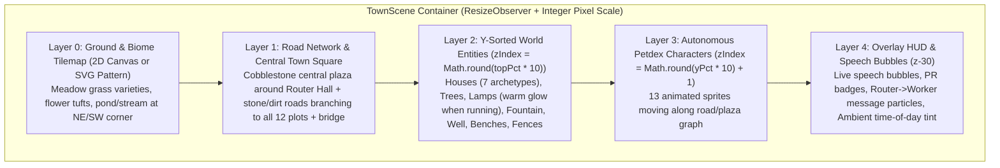
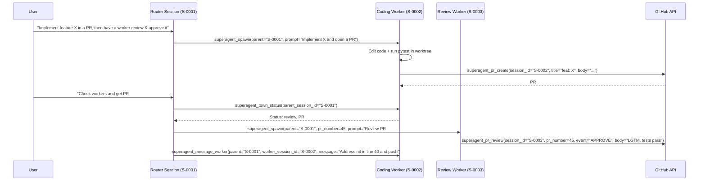
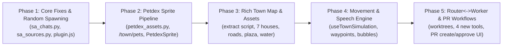

# Superagent Towns & Router/Worker Evolution — Implementation Plan & Handover

> **Status:** ✅ **Implemented & Merged on `main` (`v0.6.0`, commit `ebeed22`)**  
> **Target codebase:** `hermes-superagent` (`v0.5.10` → `v0.6.0`)  
> **Scope:** Desktop Towns renderer (`desktop/plugin.js`), asset pipeline (`dashboard/town_assets.py`, `dashboard/petdex_assets.py`, `scripts/generate_town_and_pet_assets.py`, `assets/town/`), Router↔Worker orchestration & GitHub PR workflows (`sa_chats.py`, `sa_tools.py`, `sa_schemas.py`, `sa_runner.py`, `sa_github.py`, `dashboard/plugin_api.py`, `sa_settings.py`, `plugin.yaml`), and cross-cutting bugfixes/hardening.

## Handover Summary (`v0.6.0`)

| Workstream | Status | Key Landed Files | Verification |
| :--- | :---: | :--- | :--- |
| **1. Randomised Spawning & Petdex.dev Sprites** | ✅ Done | `sa_chats.py`, `dashboard/petdex_assets.py`, `assets/town/pets/` (`catalog.json` + 8 WebP sheets), `dashboard/plugin_api.py` (`/town/pets`, `/town/pets/reroll`), `desktop/plugin.js` (`PetdexSprite`, `townHash`) | `tests/test_petdex_assets.py`, `tests/test_towns.py` |
| **2. Rich Pixel-Art Town Environment** | ✅ Done | `assets/town/*.png` (26 PNGs: 7 worker houses `house-a..g`, `road-h/v`, `plaza-stone`, `water`, `bridge`, `well`, `bench`, `flowers`, `signpost`), `dashboard/town_assets.py`, `assets/town/ATTRIBUTION.md`, `desktop/plugin.js` (`TownScene`) | `tests/test_towns.py`, `tests/towns_render_probe.mjs` |
| **3. Autonomous Sprite Movement & Speech Bubbles** | ✅ Done | `desktop/plugin.js` (`useTownSimulation`, `TownActor`, `TownSpeechBubble`, `deriveSpeechBubble`), `sa_chats.py` (`list_towns` `recent_events` + `message_count`) | `tests/towns_render_probe.mjs` (`town render probe: ok`) |
| **4. Router↔Worker Messaging, Worktrees & PR Create/Approve** | ✅ Done | `sa_github.py` (`prepare_worker_worktree`, `commit_and_push_session`, `create_pr`, `create_review`), `sa_schemas.py`, `sa_tools.py`, `sa_runner.py`, `sa_settings.py`, `plugin.yaml`, `dashboard/plugin_api.py`, `desktop/plugin.js` (`CreatePrBox`, `CommentBox`, dispatch menu) | `tests/test_github.py`, `tests/test_tools.py`, `tests/test_settings.py` |
| **5. Observed Bugs & Hardening** | ✅ Done | `sa_sources.py` (fail-closed empty `allowed_users`), `desktop/plugin.js` (`townNavRef`, `registerHouse` ref cache), `dashboard/plugin_api.py` & `sa_watcher.py` (`reasoning_effort` propagation), `tests/towns_render_probe.mjs` (CRLF fix), `tests/test_cli.py` (`HERMES_HOME` isolation) | `tests/test_sources.py`, `tests/test_cli.py`, `tests/test_release.py` (`539 passed`) |
| **6. Stacking-Context Fix, Town HUD & Lifecycle Housekeeping** | ✅ Done | `desktop/plugin.js` (`isolation: isolate; z-index: 0` on `TownScene`/`body`, internal `zIndex` `3..25`, `z-40` drawers/dialogs, Town HUD filter pills, pause toggle, SVG Router↔worker paths, **↻ Retry failed (N)**, cascade archive), `sa_chats.py` (`cascade=True`, `active_workspace_paths`), `sa_github.py` (`prune_worktrees`), `dashboard/plugin_api.py` (`/towns/{id}/retry-failed`, `/workspaces/cleanup`), `sa_cli.py` (`cleanup`) | `tests/towns_render_probe.mjs`, `tests/test_towns.py` (`539 passed`) |

---

## Table of Contents

1. [Executive Summary & Current-State Diagnosis](#1-executive-summary--current-state-diagnosis)
2. [Workstream 1 — Randomised Spawning & Petdex.dev Character Sprites](#2-workstream-1--randomised-spawning--petdexdev-character-sprites)
3. [Workstream 2 — Transforming the Grass Patch into a Living Pixel-Art Town](#3-workstream-2--transforming-the-grass-patch-into-a-living-pixel-art-town)
4. [Workstream 3 — Autonomous Sprite Movement, Pathfinding & Speech Bubbles](#4-workstream-3--autonomous-sprite-movement-pathfinding--speech-bubbles)
5. [Workstream 4 — Router↔Worker Communication, PR Creation & PR Approval Workflows](#5-workstream-4--routerworker-communication-pr-creation--pr-approval-workflows)
6. [Workstream 5 — Observed Bugs, Architectural Debt & Polish](#6-workstream-5--observed-bugs-architectural-debt--polish)
7. [Database, Settings & API Contract Summary](#7-database-settings--api-contract-summary)
8. [Phased Rollout & Verification Matrix](#8-phased-rollout--verification-matrix)

---

## 1. Executive Summary & Current-State Diagnosis

The v0.5.10 vertical slice established the **Superagent Towns** paradigm (`parent_session_id`, `town_slot`, `GET /towns`, `superagent_spawn`, and the popup `TownChatDialog`), but the visual scene and multi-agent coordination remain minimal:

| Area | Current Implementation (v0.5.10) | Root Cause / Limitation |
| :--- | :--- | :--- |
| **1. Spawning & Avatars** | `ChatStore.create_session` (`sa_chats.py:538-560`) allocates the **lowest free slot** (`0, 1, 2…`) sequentially. Every character uses the same 48×64 `person.png` with 8 CSS `hue-rotate` filters (`TOWN_PERSON_TONES` in `desktop/plugin.js:116`), cycling only row 0 (`backgroundPosition: '0 0'`). | Sequential slot allocation always fills top-left/top-right corners in the same order. `person.png` has no personality variety, and 3 of its 4 directional rows are unused. |
| **2. Town Environment** | `TownScene` (`desktop/plugin.js:4033-4154`) tiles a single 64×32 `grass.png` at `128px × 64px`, overlays one CSS `radial-gradient` brown ellipse (`plaza`), 7 fixed trees, and 7 props, and only extracts 4 of the 8 buildings from Hermes Town (`scripts/extract_hermes_town_assets.py:26-35`). | Looks like houses floating on a flat green lawn. No roads/cobblestone paths connecting plots to the Router hall, no water/bridges/fences/plaza paving, and `library`, `post`, and `observatory` from the Hermes Town atlas are unused. |
| **3. Sprite Life & Speech** | `.superagent-town-person` (`desktop/plugin.js:3916-3923`) runs `superagent-town-walk` infinitely in place beneath its house for **all** statuses (even `failed`, `cancelled`, or `review`). No `requestAnimationFrame` loop, no coordinate state, no speech bubbles. | Characters are static DOM `<span>` children inside `<button>` (`TownHouse`, line 3999). `last_event` and `recent_events` are never surfaced in `TownScene`. |
| **4. Router↔Worker & PRs** | Router can only fire-and-forget `superagent_spawn` (`sa_tools.py:86`). It cannot inspect worker results, message an existing worker, or coordinate reviews. Prompt rules (`sa_runner.py:200`, `sa_github.py:391`) hard-forbid commits/PRs, and `GitHubClient` (`sa_github.py`) lacks branch push, `POST /pulls`, and `POST /pulls/{n}/reviews` (APPROVE / REQUEST_CHANGES). | One-way spawn leaves the Router blind after delegation. Workers edit the shared `repo_path` directly (risking dirty-tree collisions when 2+ workers run) and have no sanctioned path to open a PR or let a Router/reviewer agent approve one. |
| **5. Codebase Issues** | Stale closure in keyboard handler (`desktop/plugin.js:5030-5079`), un-memoized `TownHouse` with unstable `registerHouse` ref callbacks, `GitHubSource` (`sa_sources.py:117`) fail-open when `allowed_users` is empty, `list_towns` omitting `recent_events`, and `create_chat` dropping `reasoning_effort` on `launch_turn`. | Causes broken `ArrowLeft`/`ArrowRight` navigation, unnecessary DOM churn every 2s poll, and subtle behavioral inconsistencies. |

---

## 2. Workstream 1 — Randomised Spawning & Petdex.dev Character Sprites

### 2.1 Randomised Plot Spawning & Spawn Coordinates

#### Current Behavior
- **Plot allocation (`sa_chats.py:548-550`):**
  ```python
  for candidate in range(MAX_TOWN_WORKERS):
      if candidate not in used_slots:
          slot = candidate
          break
  ```
  Every town populates plots in identical `0 → 1 → 2 → 3` order.
- **House sprite (`desktop/plugin.js:3881-3883`):** `townHash(sessionId) % 4` — because `S-0001`, `S-0002`, `S-0003` differ by 1 in the last char (`hash * 31 + charCode`), consecutive workers always cycle predictably `house-a → house-b → house-c → house-d`.

#### Planned Changes
1. **Randomised Free-Slot Selection (`sa_chats.py`):**
   - In `ChatStore.create_session` (lines 538–560), compute `free_slots = [c for c in range(MAX_TOWN_WORKERS) if c not in used_slots]`.
   - Pick `slot = random.choice(free_slots)` (using `secrets.choice` or `random.SystemRandom().choice` so even same-second spawns pick independent plots) before inserting into `chat_sessions`.
   - Persist `town_slot` in SQLite as today so once spawned, a house **never jumps on poll/reload**.
2. **Per-Plot Micro-Jitter & Better Hash Mixing (`desktop/plugin.js`):**
   - Replace the weak multiplier-31 `townHash` (`desktop/plugin.js:3872`) with `fmix32` / Murmur3-style avalanche mixing so sequential IDs (`S-0002`, `S-0003`) produce uncorrelated hashes across house styles, spawn offsets, and idle timings.
   - Add a deterministic per-session spawn offset around the house doorstep (`±18px` X, `+12..28px` Y) so sprites don't all stand dead-center at `50%` under their roof.
   - Persist an explicit `avatar_slug` column on `chat_sessions` (assigned randomly at session creation for both root Routers and child Workers) so each agent's chosen character sprite is durable across reloads and devices.

### 2.2 Petdex.dev Integration Architecture

#### Understanding the Petdex Ecosystem & Format
Probing `https://petdex.dev/api/manifest` reveals the exact upstream contract:
- **Catalog endpoint:** `GET https://petdex.dev/api/manifest` returns `{ generatedAt, total: 5208, pets: [...] }`.
- **Entry schema:**
  ```json
  {
    "slug": "boba",
    "displayName": "Boba",
    "kind": "character",          // "character" (2656) | "creature" (2012) | "object" (540)
    "submittedBy": "...",
    "spritesheetUrl": "https://assets.petdex.dev/pets/boba-.../sprite.webp",
    "petJsonUrl": "https://assets.petdex.dev/pets/boba-.../petjson.json",
    "zipUrl": "https://assets.petdex.dev/pets/boba-.../zip.zip",
    "spriteVersionNumber": 1      // 1 (8x9 grid) or 2 (8x11 grid)
  }
  ```
- **Atlas geometry:**
  - Frame cell size: **`192 × 208 px`** per frame, **8 columns** per row.
  - **v1 (`1536 × 1872 px`, 9 rows)** and **v2 (`1536 × 2288 px`, 11 rows)** row mapping:
    | Row Index | Petdex State | Superagent Session Mapping |
    | :---: | :--- | :--- |
    | `0` | `idle` | `idle`, `observed`, or stationary pause while wandering |
    | `1` | `running-right` | Moving right (`vx > 0`) |
    | `2` | `running-left` | Moving left (`vx < 0`) |
    | `3` | `waving` | Newly spawned (`building === true`), greeting another sprite, or Router delegating |
    | `4` | `jumping` | Just completed turn / celebration transition (`running → review`) |
    | `5` | `failed` | `status === 'failed'` or `status === 'cancelled'` |
    | `6` | `waiting` | `status === 'queued'` (waiting for worker semaphore slot) |
    | `7` | `running` | `status === 'running'` while working at desk/plaza |
    | `8` | `review` | `status === 'review'` (awaiting human or Router inspection) |

#### Why a Backend Proxy + Downsampler is Required
1. **Renderer transport & CSP:** As documented in `dashboard/town_assets.py:3-8`, the Hermes desktop plugin only guarantees `ctx.rest` JSON transport, and Electron host CSP may block direct `https://assets.petdex.dev` image loads.
2. **Bandwidth & GPU memory:** Raw Petdex `sprite.webp` atlases are `1536×1872` (~1.5–2.2 MB each). Loading 13 raw atlases (1 Router + 12 Workers) in DOM would consume ~26 MB of network transfer and >150 MB of decoded RGBA GPU textures.
3. **Downsampling optimization:** In the town scene, characters render at `48×52 px` (1/4 of `192×208`). Downsampling the 8×9 sheet by 4× on the Python backend with Pillow (`Image.Resampling.NEAREST` or `BOX` to preserve pixel art) shrinks the atlas to **`384 × 468 px`** (~35–60 KB WebP/PNG) — a **35× size reduction** that fits effortlessly in `ctx.rest` data URLs and disk cache.

#### Backend Implementation (`dashboard/petdex_assets.py` & `dashboard/plugin_api.py`)
1. **New module `dashboard/petdex_assets.py`:**
   - **Curated Bundled Fallback Pool:** Ship 8–12 pre-downsampled (`384×468`) community-favorite Petdex character/creature sheets in `assets/town/pets/<slug>.webp` (plus `assets/town/pets/catalog.json` and attribution in `assets/town/ATTRIBUTION.md`) so offline installs and tests work with zero network calls.
   - **Live Manifest Cache (`<data_dir>/cache/petdex/manifest.json`):**
     - Lazily fetches `https://petdex.dev/api/manifest` (timeout 10s, TTL 24 hours), filtering to `kind in ("character", "creature")` (excluding `"object"` unless opted in via settings).
     - Strict URL validation: only `https://petdex.dev/` and `https://assets.petdex.dev/pets/` URLs are ever requested (`urllib.request.urlopen`).
   - **On-Demand Sprite Fetch, Downsample & Disk Cache (`<data_dir>/cache/petdex/sprites/<slug>.webp`):**
     - When a session is assigned `avatar_slug`, backend checks `assets/town/pets/<slug>.webp` then `<data_dir>/cache/petdex/sprites/<slug>.webp`.
     - On cache miss, downloads `spritesheetUrl` (capped at 5 MB max read), crops to the standard 8×9 grid (`1536×1872`), resizes to `384×468` (`48×52` per cell) using Pillow, saves atomically to `<data_dir>/cache/petdex/sprites/<slug>.webp` (with LRU eviction above 100 cached pets), and returns a `data:image/webp;base64,...` data URL.
     - If offline or fetch fails, falls back gracefully to a random bundled pet from `assets/town/pets/`.
   - **Random Picker (`pick_random_pet(exclude: set[str]) -> dict`):**
     - Picks uniformly at random from the cached Petdex manifest (or bundled pool if offline), avoiding slugs already active in the same town so all 13 inhabitants of a town are distinct characters.
2. **New API Routes (`dashboard/plugin_api.py`):**
   - `GET /town/pets?slugs=slug1,slug2,...`: Batch-returns `{ ok: True, pets: { <slug>: { slug, display_name, kind, submitted_by, frame_width: 48, frame_height: 52, cols: 8, rows: 9, data_url: "data:image/webp;base64,..." } } }` for the active town's inhabitants.
   - `POST /town/pets/random`: Re-rolls a session's `avatar_slug` (or re-rolls all sprites in the current town) so the user can click a "🎲 Reroll Sprites" button in the town header or house menu.
3. **Frontend `PetdexSprite` Component (`desktop/plugin.js`):**
   - Renders a `48×52 px` element (scaled by plot scale) using CSS sprite-sheet stepping across the 8 columns (`@keyframes superagent-petdex-anim` from `0` to `-336px` in `steps(8, end)`).
   - Selects the active row `0..8` (`backgroundPositionY: -row * frameHeight`) based on the sprite's live state (`idle`, `running-right`, `running-left`, `waving`, `jumping`, `failed`, `waiting`, `running`, `review`).
   - Shows the pet's `displayName` in the house tooltip (e.g. `Worker house S-0002 (Boba): Fix the parser — running`).

---

## 3. Workstream 2 — Transforming the Grass Patch into a Living Pixel-Art Town

### 3.1 Visual & Structural Diagnosis of Current `TownScene`
Currently (`desktop/plugin.js:4073-4145`):
- The ground is a single repeating `grass.png` tile (`backgroundSize: 128px 64px`) with a semi-transparent brown CSS `radial-gradient` (`plaza`).
- Only 4 building sprites (`house-a..d`: house, tavern, workshop, forge) + `house-router` (hall) are extracted in `scripts/extract_hermes_town_assets.py:138-151`, leaving `library`, `post`, and `observatory` (already defined in `BUILDINGS` at lines 26–35!) and 5 of the 8 props in `props.png` unused.
- All houses (`z-10`) sit on the same z-plane regardless of vertical `top%`, and trees/props (`z-0`) never depth-sort with houses or characters.
- Plot positions are raw percentages (`left: 10/30/70/90%`, `top: 18/50/82%`) with no roads, districts, water, fences, or plaza masonry.

### 3.2 Expanding the Vendored Asset Set (`scripts/extract_hermes_town_assets.py` & `assets/town/`)
1. **Extract All 8 Hermes Town Buildings (MIT):**
   - Add `house-e.png` (`library`), `house-f.png` (`post`), and `house-g.png` (`observatory`) to `scripts/extract_hermes_town_assets.py` and `dashboard/town_assets.py` (`ASSETS` allowlist).
   - Worker houses now draw from **7 distinct building archetypes** (cottage, tavern, workshop, forge, library, post office, observatory), or pick contextually from the task prompt (e.g., `"test"` / `"debug"` → observatory/library; `"build"` / `"refactor"` → workshop/forge; PR review → post office) with random fallback.
2. **Extract Remaining Hermes Town Props & Terrain Tiles:**
   - Extract the remaining cells from `props.png` (`well`, `signpost`, `bench`, `barrel/crate`, `flowerbed`/`statue`) in `scripts/extract_hermes_town_assets.py`.
   - Extract terrain tiles from `rpg-tileset.png` / `magecity.png` (already cleared in `assets/town/ATTRIBUTION.md` under CC-BY-SA 3.0 / Eliza-Town provenance):
     - `path-stone.png` (cobblestone road & central plaza flagstones)
     - `path-dirt.png` (secondary dirt lanes leading to outer plots)
     - `water.png` + `bridge.png` (a small creek/pond on the town edge with a wooden/stone bridge)
     - `fence-h.png`, `flower-a.png`, `flower-b.png` (garden borders, flower patches, hedges)
   - Document every new crop rectangle and license in `assets/town/ATTRIBUTION.md`.

### 3.3 Layered Town Map Architecture (`TownMapCanvas` / SVG + Depth-Sorted DOM)
Replace the flat grass `<div>` + radial gradient with a rich, multi-layered town map inside `TownScene`:



#### Specific Town Design Improvements
1. **Central Cobblestone Plaza & Road Network:**
   - Render a paved stone **Town Square** (`38%..62%` X, `38%..66%` Y) around the central Router Hall (`50%, 48%`), complete with the town fountain at the southern plaza court (`50%, 68%`), lamp posts at the four plaza corners, benches, and a town noticeboard/signpost.
   - Render **Main East–West Avenue** (`top: 50%`) and **North/South Neighborhood Lanes** (`top: 22%`, `top: 78%`) with cobblestone/dirt path tiles and short front-walkways connecting each of the 12 worker plots (`TOWN_PLOTS`) to the road network. Even empty plots show a subtle fenced garden lot or foundation marker (`plot-empty`) so the town looks intentionally planned whether 1 or 12 workers exist.
2. **Town Districts & Landmarks:**
   - **North Commons:** Library/Observatory plots, pine/oak grove, stone well.
   - **Central Civic Plaza:** Router Town Hall, fountain, noticeboard, warm streetlamps.
   - **South Artisans' Quarter & Creek:** Workshop/Forge/Tavern plots, a meandering brook in the bottom-left/bottom-right corner crossed by a small pixel bridge, rocks, and bushes.
3. **Dynamic Lighting & Activity Ambience:**
   - Streetlamps (`lamp.png`) and building windows emit a subtle warm radial glow when workers are actively `running`.
   - Construction plots show scaffolding/dust puffs during `TOWN_BUILD_MS` instead of only a CSS scale bounce.
4. **Y-Sorted Depth (`z-index`) & Responsive Scaling:**
   - Assign `style.zIndex = Math.round(topPct * 10)` to every tree, prop, house, and moving character so southern entities naturally occlude northern ones.
   - Attach a `ResizeObserver` to the scene container (`desktop/plugin.js`) to compute a responsive scale factor (`clamp(0.65, min(width / 1024, height / 520), 1.25)`), eliminating house/Router/tree overlaps on narrower viewports.

---

## 4. Workstream 3 — Autonomous Sprite Movement, Pathfinding & Speech Bubbles

### 4.1 Decoupling Characters from House Buttons
Currently (`desktop/plugin.js:3999-4014`), each person `<span>` is nested *inside* `TownHouse`'s `<button>`. As a result, a character cannot leave its house's bounding box.

#### Architectural Change
- Lift all character sprites out of `TownHouse` into a dedicated `TownPopulation` layer inside `TownScene` (`desktop/plugin.js`).
- Each inhabitant has a stable actor record keyed by `session.id` (the Router session + each worker in `town.workers`).
- Clicking a walking character sprite or its speech bubble opens that session's `TownChatDialog` (`onOpen(session.id)`), identical to clicking its house.

### 4.2 Waypoint Graph & State-Driven Steering (`useTownSimulation` Hook)
Define a lightweight waypoint graph matching the town roads and landmarks (in normalized `0..100` scene coordinates):
- **Nodes:**
  - `home[slot]`: doorstep of each worker's house (`plot.left`, `plot.top + 7`).
  - `router_door`: front steps of the Router Hall (`50, 55`).
  - `plaza_NW (42, 46)`, `plaza_NE (58, 46)`, `plaza_SW (42, 62)`, `plaza_SE (58, 62)`, `fountain (50, 70)`, `noticeboard (44, 54)`.
  - Road intersections along the North (`y=24`), Middle (`y=52`), and South (`y=80`) avenues.

#### Behavior State Machine per Session Status
Driven by a single `requestAnimationFrame` loop (throttled to ~20–30 fps for pixel-art authenticity and low CPU usage, and paused when `document.hidden` or `reducedMotion` is true):

| Session Status | Movement Behavior | Petdex Animation Row |
| :--- | :--- | :--- |
| **`building` (just spawned)** | Spawns at `router_door` (`50, 55`), waves briefly, then walks along the road network to its assigned `home[slot]`. | Row `3` (`waving`) → Row `1`/`2` (`running-right`/`left`) |
| **`queued`** | Paces near `router_door` or the town noticeboard waiting for a worker slot. | Row `6` (`waiting`) when paused; Row `1`/`2` when pacing |
| **`running`** | Alternates between working at `home[slot]` (`running` work animation, 6–10s), walking to the plaza/fountain/library to "gather context", or visiting `router_door` when a tool call runs. | Row `7` (`running` / working) when stationary; Row `1`/`2` (`running-right`/`left`) while walking |
| **`review`** | Walks from `home[slot]` to the central plaza (`fountain` / `router_door`), jumps once on arrival, and strolls around the plaza ready for inspection. | Row `4` (`jumping` on transition) → Row `8` (`review`) / Row `0` (`idle`) |
| **`idle`** | Leisurely wanders between plaza benches, trees, fountain, and neighbors' houses; pauses to wave (`Row 3`) when passing within `6%` distance of another sprite. | Row `0` (`idle`), Row `1`/`2` (walking), Row `3` (`waving` on proximity) |
| **`failed` / `cancelled`** | Stays near `home[slot]` (or walks home slowly) and plays the `failed` animation. | Row `5` (`failed`) |

### 4.3 Live Speech Bubbles & Agent Chatter

#### Data Sources (Zero Fabricated Activity, Plus Contextual Banter)
1. **Real Telemetry Bubbles (Primary):**
   - **Backend enrichment (`sa_chats.py:750-864`):** Update `ChatStore.list_towns()` so active/recent sessions in `towns` and `town.workers` include:
     - `recent_events` (via `self._recent_events(conn, ids)`, already implemented for `list_sessions` at `sa_chats.py:737` but currently missing from `list_towns`!).
     - `last_message_preview`: 100-char snippet of the latest assistant/user message or `last_event`.
   - **Formatting (`formatSpeechBubble(session)` in `desktop/plugin.js`):**
     - When `session.last_event` changes (e.g. `tool: edit_file {"path": "sa_runner.py"}` → `"🔧 Editing sa_runner.py…"`, `tool: run_command {"cmd": "pytest"}` → `"🧪 Running pytest…"`, `spawned: S-0004` → `"📣 Dispatched S-0004!"`, `commented: PR #12` → `"💬 Posted review on PR #12"`), pop a speech bubble above the sprite for 6 seconds.
2. **Router↔Worker & Social Interactions:**
   - When the Router spawns or messages a worker, the Router sprite faces the worker's direction and shows `"📋 @S-0003: <title>"`, while a messenger bubble/spark travels from the Router to the worker.
   - When two wandering sprites pass near each other in the plaza, they pause for 2 seconds, face each other (`waving` row 3), and exchange brief status-aware banter grounded in their actual state (e.g., Worker A (`running`): *"Still working on: Fix parser…"* ↔ Worker B (`review`): *"Mine's ready for review! (#S-0003)"*, or Router: *"How's slot 2 going?"*).
3. **Speech Bubble UI (`TownSpeechBubble` component):**
   - Pixel-styled speech pill anchored above the sprite (`-translate-y-full -mt-1.5`), max width `11rem`, 2-line clamp, subtle tail pointer, fade-in/pop animation, clickable to open that session's chat dialog.
   - Maximum 3 simultaneous ambient bubbles on screen at once (live tool/status-transition events always take priority) so the town feels lively without becoming visual clutter.

---

## 5. Workstream 4 — Router↔Worker Communication, PR Creation & PR Approval Workflows

### 5.1 Design Principles & Safety Gates
Right now, `DESIGN.md` §9 and `tasks/2026-11-07-superagent-towns-brief.txt` enforce a hard rule: *"No automatic commits, pushes, merges, PR creation, or PR comments."*  
To support **worker PR creation** and **Router→Worker PR review/approval** safely, we make this an **explicit, opt-in capability** governed by settings and per-town permissions:

| New Setting (`sa_settings.py` & `plugin.yaml`) | Type & Default | Purpose |
| :--- | :--- | :--- |
| `allow_worker_git_Worktree` | `bool = True` | Isolate each spawned town worker into its own git worktree (`<data_dir>/workspaces/session-<id>`) so parallel workers never corrupt each other's working tree. |
| `allow_worker_pr_create` | `bool = False` | Allow workers (via tool or UI/Router action) to create a feature branch, commit, push, and open a GitHub Pull Request. |
| `allow_router_pr_approve` | `bool = False` | Allow the Router (or a designated review worker) to instruct workers to submit PR reviews (`COMMENT`, `APPROVE`, `REQUEST_CHANGES`) and/or approve PRs after verification. |
| `github_pr_base_branch` | `str = ""` | Default base branch for worker-created PRs (empty = repo's `default_branch` from GitHub API). |
| `github_pr_draft_by_default` | `bool = False` | Open worker-created PRs as drafts when `True`. |

Both toggles surface in the desktop **⚙ Settings** drawer and **GitHub** drawer with clear explanations, and default to `False` so existing observe-first installs stay 100% non-publishing until enabled.

### 5.2 Isolated Per-Worker Git Worktrees (`sa_github.py` & `sa_runner.py`)
When a Router spawns 2+ workers in the same repo today, all workers run in the same `repo_path` directory (`sa_tools.py:127`), stepping on each other's uncommitted changes and making per-worker diffs/PRs impossible.
- **New helper `sa_github.prepare_worker_worktree(repo_path, session_id, workspace_root, base_ref="HEAD") -> dict`:**
  - Creates a dedicated branch `superagent/<session_id>-<slug>` in `<data_dir>/workspaces/worker-<session_id>` via `git -C <repo_path> worktree add -b superagent/<session_id> <dest> <base_ref>`.
  - `sa_runtime.runner_root()` already whitelists `<data_dir>/workspaces` (`sa_runtime.py:59`), so containment checks (`resolve_repo_path`) pass out of the box!
  - Now every worker house has an isolated working tree, an isolated `GET /chats/{id}/diff`, and its own clean branch ready to push as a PR.

### 5.3 Bi-Directional Router↔Worker Communication Tools (`sa_schemas.py` & `sa_tools.py`)
Currently, `TOOLSET = "superagent"` only gives the Router `superagent_spawn` (fire-and-forget). Add three new tools to `sa_schemas.py` and `sa_tools.py` (registered in `__init__.py` and exposed to Router sessions via `router_toolset="superagent"`, and selectively to workers):



#### Tool 1: `superagent_town_status` (Router inspects its workers)
- **Parameters:** `parent_session_id: str`, `worker_session_id: Optional[str] = None`, `include_diff: bool = False`.
- **Behavior:** Returns the live status of all workers in the town (or detailed transcript + `collect_diff` stat + `pr_number`/`pr_url` for a specific worker). Lets the Router see what its workers accomplished, whether tests passed, and what PR numbers they opened.

#### Tool 2: `superagent_message_worker` (Router communicates with an existing worker)
- **Parameters:** `parent_session_id: str`, `worker_session_id: str`, `message: str`, `action: Optional["follow_up" | "create_pr" | "review_pr" | "approve_pr"] = "follow_up"`, `pr_number: Optional[int] = None`.
- **Behavior:**
  - Validates that `worker_session_id` belongs to `parent_session_id` (`worker["parent_session_id"] == parent_id`) and is not currently `queued`/`running`.
  - Records a `router_message` event on both the Router and Worker (`store.add_event(worker_id, "router_message", f"from {parent_id}: {message[:120]}")`) — which also triggers a visual messenger animation and speech bubble in `TownScene`!
  - Appends the message to the worker's transcript (`role="user"`, prefixed with `[Router S-xxxx]: ...` or action instructions) and calls `runner.launch_turn(worker_id, ..., resume_session_id=worker["hermes_session_id"])`.

#### Tool 3: `superagent_pr_create` (Worker or Router creates a Pull Request from a session's changes)
- **Parameters:** `session_id: str`, `title: str`, `body: str = ""`, `branch: str = ""`, `base: str = ""`, `draft: Optional[bool] = None`, `commit_message: str = ""`.
- **Gate check:** Requires `settings["allow_worker_pr_create"] is True` (returns a clear JSON error explaining how to enable `allow_worker_pr_create` in Settings if `False`).
- **Git + GitHub flow (`sa_github.py`):**
  1. New helper `sa_github.commit_and_push_session(repo_path, github_repo, token, *, branch, commit_message)`:
     - Validates working tree has changes via `sa_diff.collect_diff(repo_path)`.
     - Creates/switches to `branch` (default `superagent/s-<num>-<slug>`, rejecting protected branch names like `main`/`master`).
     - Runs `git add -A` and `git commit -m <commit_message>` (with author/committer identity from git config or `superagent[bot]`).
     - Pushes to `https://github.com/{github_repo}.git` `HEAD:refs/heads/{branch}` using the one-shot `-c http.extraHeader=Authorization: Basic <base64>` credential pattern already proven in `prepare_pr_checkout` (`sa_github.py:300-311`) — **never writing the token to `.git/config` or remote URLs**.
  2. New `GitHubClient.create_pr(title, head, base, body="", draft=False) -> dict` (`POST /repos/{repo}/pulls`):
     - Creates the PR (or if a PR for `head` already exists on `session["pr_number"]`, pushes the new commit to update the existing PR and returns it).
  3. Updates `chat_sessions` (`pr_number`, `pr_url`, `github_repo`) and logs a `pr_created` event (`PR #<n>: <html_url>`).

#### Tool 4: `superagent_pr_review` (Worker or Router reviews / approves / requests changes on a PR)
- **Parameters:** `session_id: str`, `pr_number: Optional[int] = None`, `event: "APPROVE" | "REQUEST_CHANGES" | "COMMENT"`, `body: str`, ` merge: bool = False`.
- **Gate check:**
  - `COMMENT` is allowed whenever a GitHub token is configured.
  - `APPROVE` and `REQUEST_CHANGES` (and optional `merge`) require `settings["allow_router_pr_approve"] is True`.
- **GitHub API methods (`sa_github.py`):**
  - `GitHubClient.create_review(number: int, event: str, body: str) -> dict`: calls `POST /repos/{repo}/pulls/{number}/reviews` with `{"event": event, "body": body[:BODY_LIMIT]}`.
  - Note on GitHub self-approval constraint: GitHub's REST API returns `422 Unprocessable Entity ("Can not approve your own pull request")` if the token belongs to the exact same GitHub account that opened the PR. `create_review` will catch HTTP 422 with `"approve your own pull request"` and either:
    - Fall back to posting a formal `COMMENT` review prefixed with `✅ **Approved by Superagent (<session_id>)**\n\n<body>` (when `fallback_on_self_approve=True`), or
    - Return a clear diagnostic suggesting a separate reviewer token (`github_reviewer_token` setting) if true GitHub-native approval on self-authored PRs is desired.
  - Optional `GitHubClient.merge_pr(number: int, merge_method: str = "squash", commit_title: str = "") -> dict` (`PUT /repos/{repo}/pulls/{number}/merge`) gated behind a dedicated human confirmation / setting.

### 5.4 Updating Worker & Router System Prompts (`sa_runner.py` & `sa_github.py`)
In `sa_runner.py:167-204` (`build_prompt`) and `sa_github.py:337-397` (`build_pr_prompt`):
- Pass capability flags `can_create_pr: bool` and `can_approve_pr: bool` (derived from `sa_settings.load_settings()`).
- **When `allow_worker_pr_create=False` (default):** Keep the existing rule: `"- Do NOT commit, push, merge, or open a pull request. Leave changes in the working tree."`
- **When `allow_worker_pr_create=True`:** Replace that rule with:
  ```text
  - You are working in an isolated worktree. When your changes and tests are complete, you MAY call `superagent_pr_create` (with session_id="<id>") to commit, push a feature branch, and open a pull request if requested by the user or Router. Never run raw `git push` to main/master.
  ```
- **When `can_spawn=True` (Router prompt):** Document `superagent_town_status`, `superagent_message_worker`, `superagent_pr_create`, and `superagent_pr_review` so the Router knows it can:
  1. Spawn workers with `superagent_spawn` (passing optional `pr_number` to check out an existing PR worktree),
  2. Check worker progress with `superagent_town_status`,
  3. Send follow-up instructions or ask a worker to review/approve a PR with `superagent_message_worker`, and
  4. Approve or review PRs directly or via a worker using `superagent_pr_review`.
- **Worker toolset injection (`sa_runner.py:456-458`):** When `allow_worker_pr_create` or `allow_router_pr_approve` is enabled, include `"superagent"` in worker `toolsets` as well (while `superagent_spawn` and `superagent_message_worker` still enforce `parent.get("parent_session_id") is None` so workers cannot spawn sub-workers).

### 5.5 Desktop UI Controls for PR Creation, Review & Router Dispatch (`desktop/plugin.js` & `dashboard/plugin_api.py`)
1. **New REST Endpoints (`dashboard/plugin_api.py`):**
   - `POST /chats/{session_id}/pr` — Commit, push, and open (or update) a GitHub PR from a finished worker/router session (`title`, `body`, `base`, `draft`).
   - `POST /chats/{session_id}/review` — Submit a PR review (`event: "APPROVE" | "REQUEST_CHANGES" | "COMMENT"`, `body`) on the session's linked PR.
   - `POST /towns/{root_id}/dispatch` — Let the human or Router dispatch a "Review & Approve PR #N" worker or broadcast an instruction from the Router to a worker directly from the UI.
2. **House Dialog (`TownChatDialog` / `ChatCenter` in `desktop/plugin.js`):**
   - Next to **Diff** and **Comment on PR** (`desktop/plugin.js:2526-2897`), add:
     - **Create PR** button (visible when `diff.files.length > 0` and no `pr_number` is linked yet): opens a compact preview sheet with editable PR Title, Branch name (`superagent/s-0002-...`), Base branch, Draft checkbox, and Body (pre-filled via `default_comment_body`).
     - **Review / Approve PR** controls inside the PR Comment sheet: radio pills for **Comment**, **Approve ✅**, and **Request Changes ❌** (calling `POST /chats/{id}/review`).
     - **Ask Router to Review** action in worker house menu: sends a one-click prompt to the town's Router (`"Inspect worker S-0002's diff/PR and approve or send follow-up feedback"`).
3. **Settings Panel (`SettingsPanel` in `desktop/plugin.js:265`):**
   - Add checkboxes for:
     - **Isolate workers in git worktrees** (`allow_worker_git_worktree`)
     - **Allow workers to create branches & PRs** (`allow_worker_pr_create`)
     - **Allow Router & workers to approve/review PRs** (`allow_router_pr_approve`)

---

## 6. Workstream 5 — Observed Bugs, Architectural Debt & Polish

During the deep audit of the repository, the following concrete bugs and quality issues were identified and should be fixed as part of this plan:

### 6.1 Confirmed Bugs to Fix

1. **Bug: `ArrowLeft` / `ArrowRight` Town Switching Broken by Stale Closure (`desktop/plugin.js:5029-5079`)**
   - **Diagnosis:** The `window.addEventListener('keydown', onKeyDown)` effect at line 5029 has an empty dependency array `[]`, yet `onKeyDown` reads `towns`, `townId`, and `selectTown` directly from the initial mount closure (lines 5060–5066) when `towns` was `[]` and `townId` was `''`. Pressing `←` or `→` either does nothing (`!towns.length` returns early) or switches relative to a stale `townId`.
   - **Fix:** Store `{ towns, townId, selectTown }` in a ref (`townNavRef.current = { towns, townId, selectTown }`) updated each render (just like `newChatRef` at line 5027), and read `townNavRef.current` inside `onKeyDown`.

2. **Bug: `POST /chats` Drops `reasoning_effort` on First Turn Launch (`dashboard/plugin_api.py:1217`)**
   - **Diagnosis:** In `create_chat` (`dashboard/plugin_api.py:1198-1217`), `effort` is resolved and stored on `store.create_session(..., reasoning_effort=effort[:40])`, and `launch_turn` falls back to `session.get("reasoning_effort")` when `reasoning_effort=None`. However, in `post_chat_message` (`plugin_api.py:1260-1270`, the unresumable replacement branch) and `github_pr_work` (`plugin_api.py:1954-1979`), `reasoning_effort` is neither copied to the replacement session nor passed to `launch_turn`.
   - **Fix:** Pass `reasoning_effort=session.get("reasoning_effort")` when creating a replacement session in `post_chat_message` and `default_reasoning_effort` in `github_pr_work` and `sa_watcher.py:360-402`.

3. **Bug: `GitHubSource._to_inbound` Fails Open When `allowed_users` is Empty (`sa_sources.py:117`)**
   - **Diagnosis:** `DESIGN.md` §7, `plugin.yaml:42`, and `sa_watcher.py:312-313` all state: *"An empty allow-list means nobody, by design (fail-closed)."* Yet `GitHubSource._to_inbound` (used by the ticket engine in `sa_sources.py:117`) writes:
     ```python
     if self.allowed_users and login.lower() not in self.allowed_users:
         return None
     ```
     When `self.allowed_users` is empty (`set()`), `if self.allowed_users` is `False`, so **every GitHub user on the internet** is allowed to trigger ticket work!
   - **Fix:** Change `sa_sources.py:117` to `if not self.allowed_users or login.lower() not in self.allowed_users: return None` to match `sa_watcher.py:312`.

4. **Bug: `ChatStore.list_towns` Omits `recent_events` & `message_count` (`sa_chats.py:750-864`)**
   - **Diagnosis:** `list_sessions` (`sa_chats.py:729-743`) attaches `message_count` and `recent_events` (via `self._recent_events(conn, live_ids)`), which `ChatCenter` / live-worker cards and town speech bubbles need. `list_towns` only runs `SELECT s.* FROM chat_sessions s` without `message_count` or `_recent_events`.
   - **Fix:** Enrich `list_towns` with `message_count` and `recent_events` for all roots and workers in the returned towns.

5. **Bug: Render Probe Windows CRLF Replacement (`tests/towns_render_probe.mjs:81`)**
   - **Diagnosis:** `.replace('\r\n', '\n')` only replaces the **first** CRLF in `desktop/plugin.js`. On Windows checkouts with `core.autocrlf=true`, multiline regexes can fail unexpectedly.
   - **Fix:** Use `.replaceAll('\r\n', '\n')`.

### 6.2 Performance, Rendering & UX Improvements

1. **Eliminate Per-Poll Ref Thrashing & Re-Renders (`desktop/plugin.js:3933, 4128, 4698`):**
   - `registerHouse(id)` (`line 4698`) creates a brand-new closure on every render, causing React to detach (`null`) and re-attach every house DOM ref every 2 seconds. Cache ref callbacks per `id` in a `houseRefCallbacks = useRef({})` map and wrap `TownHouse` and `TownScene` in `memo(...)`.
   - Hoist `<style>{TOWN_CSS}</style>` so it isn't re-diffed inside `SuperagentPage` on every keystroke in the composer (`draft` state lives in `SuperagentPage`!). Even better, isolate `draft` state or memoize `TownScene` so typing in the composer does not re-render the town scene at all.
2. **Orphaned Worker & Worktree Cleanup:**
   - When a root town is deleted (`DELETE /chats/{id}`) or archived, offer a toggle or cascade option to archive/delete its child workers instead of silently stranding them as orphans.
   - Add a `hermes superagent cleanup` / settings action to prune worktrees in `<data_dir>/workspaces/` whose sessions have been deleted or archived.
3. **Rich Town HUD & Inspector:**
   - Show an optional mini-feed ticker or floating badge on houses with PR numbers (`#45`), diff stats (`+42/-8`), and elapsed runtime (`1m 24s`) directly on the house roof/signboard so the user doesn't have to click every house to see which worker changed files.
   - Add Sound / Ambient Audio toggle (optional Web Audio synthesized subtle chiral chimes on worker spawn / completion, muted by default).

---

## 7. Database, Settings & API Contract Summary

### 7.1 SQLite Schema Additions (`sa_chats.py`)
Additive migration in `ChatStore._migrate`:
```sql
ALTER TABLE chat_sessions ADD COLUMN avatar_slug TEXT;
ALTER TABLE chat_sessions ADD COLUMN branch_name TEXT;
ALTER TABLE chat_sessions ADD COLUMN worktree_path TEXT;
```
- `avatar_slug`: Persistent Petdex slug (e.g. `"boba"`, `"homelander"`, `"mecha-xiaobai"`) assigned randomly on `create_session`.
- `branch_name`: Git branch created in the worker's worktree (`superagent/s-0002-fix-parser`).
- `worktree_path`: Isolated git worktree directory if created.

### 7.2 Settings Additions (`sa_settings.py` & `plugin.yaml`)
| Key | Env Var | Default | Description |
| :--- | :--- | :--- | :--- |
| `allow_worker_git_worktree` | `SUPERAGENT_ALLOW_WORKER_WORKTREE` | `True` | Create an isolated git worktree per spawned worker. |
| `allow_worker_pr_create` | `SUPERAGENT_ALLOW_WORKER_PR_CREATE` | `False` | Allow workers/Router to commit, push feature branches, and open GitHub PRs. |
| `allow_router_pr_approve` | `SUPERAGENT_ALLOW_ROUTER_PR_APPROVE` | `False` | Allow Router/workers to submit `APPROVE` / `REQUEST_CHANGES` reviews on GitHub PRs. |
| `github_pr_base_branch` | `SUPERAGENT_GITHUB_PR_BASE_BRANCH` | `""` | Base branch for created PRs (defaults to repo's `default_branch`). |
| `github_pr_draft_by_default` | `SUPERAGENT_GITHUB_PR_DRAFT` | `False` | Open worker PRs as drafts by default. |
| `petdex_enabled` | `SUPERAGENT_PETDEX_ENABLED` | `True` | Fetch & cache random character sprites from `petdex.dev` (falls back to bundled pets when `False` or offline). |

### 7.3 New & Updated Tools (`plugin.yaml`, `__init__.py`, `sa_schemas.py`, `sa_tools.py`)
- `superagent_spawn` (Updated): Accepts optional `pr_number: int` and `use_worktree: bool` to spawn a worker directly onto an isolated PR checkout or feature worktree, and assigns a random `town_slot` and random Petdex `avatar_slug`.
- `superagent_town_status` (New): Inspect all workers in a town (statuses, last events, diff stats, PR links).
- `superagent_message_worker` (New): Send follow-up instructions, PR review requests, or approval commands from the Router to a specific worker session.
- `superagent_pr_create` (New): Commit worktree changes, push a `superagent/<session_id>` branch, and open/update a GitHub PR (gated by `allow_worker_pr_create`).
- `superagent_pr_review` (New): Submit a GitHub PR review (`COMMENT`, `APPROVE`, `REQUEST_CHANGES`) from a worker or Router session (gated by `allow_router_pr_approve` for approvals).

### 7.4 New & Updated REST Endpoints (`dashboard/plugin_api.py`)
- `GET /town/pets?slugs=...` — Return downsampled (`384×468`) Petdex sprite sheets + metadata as cached data URLs.
- `POST /town/pets/reroll` — Re-randomize `avatar_slug` for one session or an entire town.
- `POST /towns/{root_id}/dispatch` — Dispatch a follow-up instruction, `create_pr`, `review_pr`, or `approve_pr` task from the town's Router to a worker.
- `POST /towns/{root_id}/retry-failed` — Batch-retry all `failed` or `cancelled` workers in a town.
- `POST /workspaces/cleanup` — Prune stale `pr-*` and `worker-*` git worktrees not referenced by active sessions (`hermes superagent cleanup` in CLI).
- `POST /chats/{session_id}/archive` & `DELETE /chats/{session_id}?cascade=true` — Support `cascade: true` on root towns to archive or delete non-busy child workers in the same transaction.
- `POST /chats/{session_id}/pr` — Commit, push, and create/update a GitHub PR from the desktop House Dialog.
- `POST /chats/{session_id}/review` — Post a GitHub PR review (`APPROVE`, `REQUEST_CHANGES`, `COMMENT`) from the desktop House Dialog.

---

## 8. Phased Rollout & Verification Matrix



### Phase-by-Phase Execution Checklist

| Phase | Files Touched | Verification / Tests |
| :--- | :--- | :--- |
| **Phase 1: Foundation Fixes & Randomised Plot Allocation** | `sa_chats.py`, `sa_sources.py`, `dashboard/plugin_api.py`, `desktop/plugin.js`, `tests/towns_render_probe.mjs`, `tests/test_towns.py` | - Unit test proving `create_session` picks random free slots in `0..11`, never collides under concurrency, and persists the chosen slot.<br/>- Unit test for `GitHubSource` fail-closed empty `allowed_users`.<br/>- Fix `ArrowLeft`/`ArrowRight` ref closure and `list_towns` `recent_events`. |
| **Phase 2: Petdex.dev Sprite Proxy, Bundled Pool & Renderer** | `dashboard/petdex_assets.py` (new), `dashboard/town_assets.py`, `dashboard/plugin_api.py`, `assets/town/pets/*`, `assets/town/ATTRIBUTION.md`, `desktop/plugin.js`, `tests/test_towns.py` | - Unit tests with mocked `urlopen` for manifest fetch, 4× Pillow downsampling (`1536×1872 → 384×468`), disk caching, domain allowlist enforcement, and offline fallback.<br/>- Render probe verifying `PetdexSprite` row selection for all 9 states (`idle`, `running`, `review`, `failed`, `waiting`, `waving`, `jumping`, `running-left/right`). |
| **Phase 3: Town Environment Overhaul** | `scripts/extract_hermes_town_assets.py`, `assets/town/*.png`, `dashboard/town_assets.py`, `desktop/plugin.js` (`TownScene`, `TownMap`) | - Re-run `extract_hermes_town_assets.py` to generate all 7 worker house types + new props + terrain tiles.<br/>- Verify `town_assets.py` allowlist and `ATTRIBUTION.md`.<br/>- Render probe checking road network, cobblestone plaza, bridge/pond, Y-sorted `zIndex`, and `ResizeObserver` scaling. |
| **Phase 4: Autonomous Movement & Speech Bubbles** | `desktop/plugin.js` (`useTownSimulation`, `TownPopulation`, `TownSpeechBubble`), `tests/towns_render_probe.mjs` | - Verify `requestAnimationFrame` waypoint steering, `prefers-reduced-motion` bypass (static positions + no rAF timers), unmount cleanup, telemetry speech bubbles from `last_event`/`recent_events`, and proximity wave/banter. |
| **Phase 5: Router↔Worker Messaging, Worktrees & PR Create/Approve** | `sa_github.py`, `sa_tools.py`, `sa_schemas.py`, `sa_runner.py`, `sa_settings.py`, `plugin.yaml`, `__init__.py`, `dashboard/plugin_api.py`, `desktop/plugin.js`, `tests/test_github.py`, `tests/test_tools.py`, `tests/test_handoff_api.py` | - Unit tests for `prepare_worker_worktree`, `commit_and_push_session`, `GitHubClient.create_pr`, and `GitHubClient.create_review` (`APPROVE`, `REQUEST_CHANGES`, self-approval 422 fallback).<br/>- Tool tests for `superagent_town_status`, `superagent_message_worker`, `superagent_pr_create`, `superagent_pr_review` (both gated-off and gated-on).<br/>- End-to-end validation: `python -m pytest -q`, `node --check desktop/plugin.js`, `node tests/towns_render_probe.mjs`, `hermes plugins validate .`, `hermes plugins doctor --ci .`. |
| **Phase 6: Stacking-Context Isolation, Town HUD & Lifecycle Housekeeping** | `desktop/plugin.js`, `sa_chats.py`, `sa_github.py`, `sa_cli.py`, `dashboard/plugin_api.py`, `tests/towns_render_probe.mjs`, `tests/test_towns.py` | - Enforce `isolation: isolate; zIndex: 0` on `TownScene` and `body`, cap internal Y-sorted `zIndex` to `3..25`, and elevate `OverlayDrawer` / `TownChatDialog` / `TownModal` to `z-40` (`ShortcutSheet` to `z-50`) so town assets never overlay Settings or drawers.<br/>- Add Town HUD filter pills (`All`, `Running`, `Review`, `Failed`, `PRs`), **⏸ Pause / ▶ Walk** toggle, and SVG Router↔worker connection paths.<br/>- Add batch **↻ Retry failed (N)** (`POST /towns/{root_id}/retry-failed`), cascade town archive/delete (`cascade=true`), and stale worktree pruning (`POST /workspaces/cleanup`, `hermes superagent cleanup`). |


